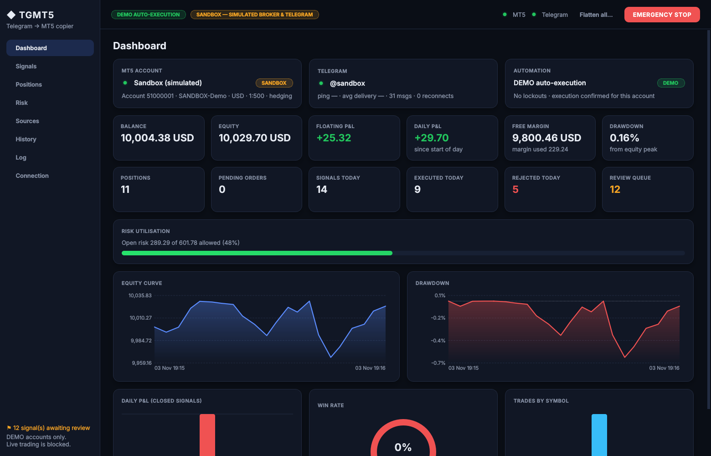
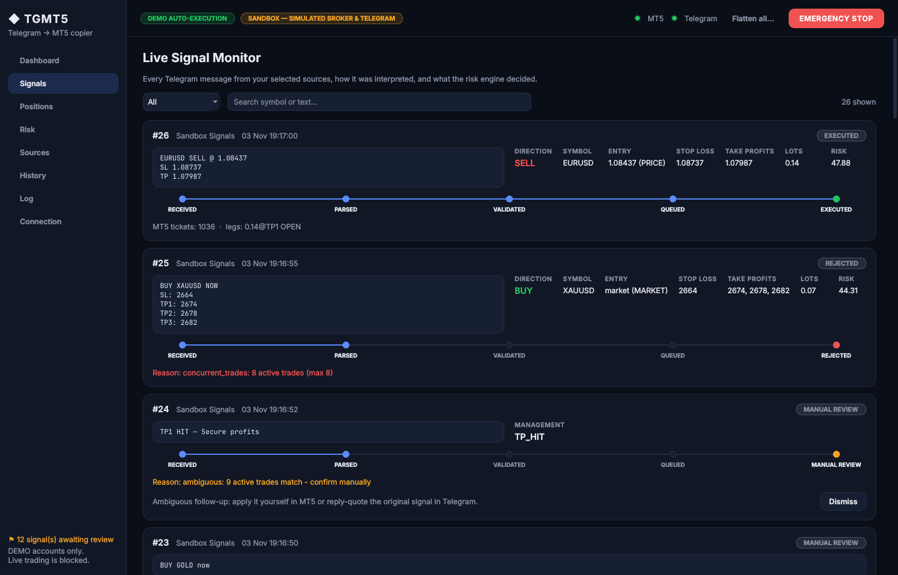
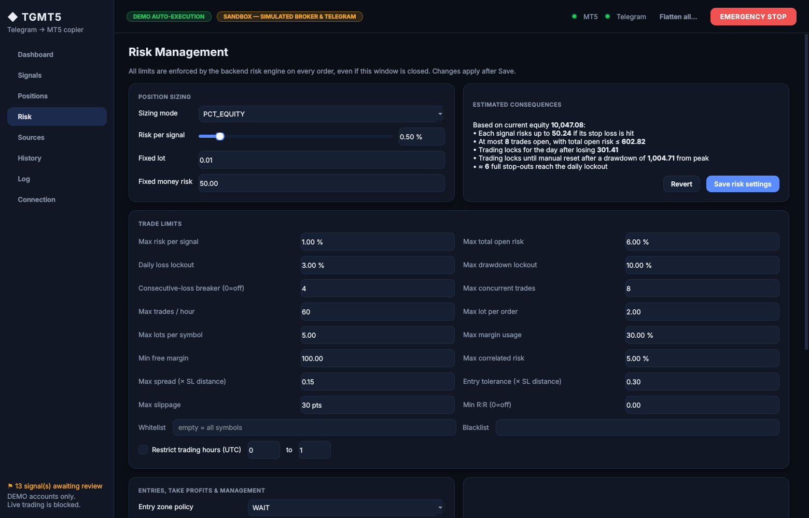
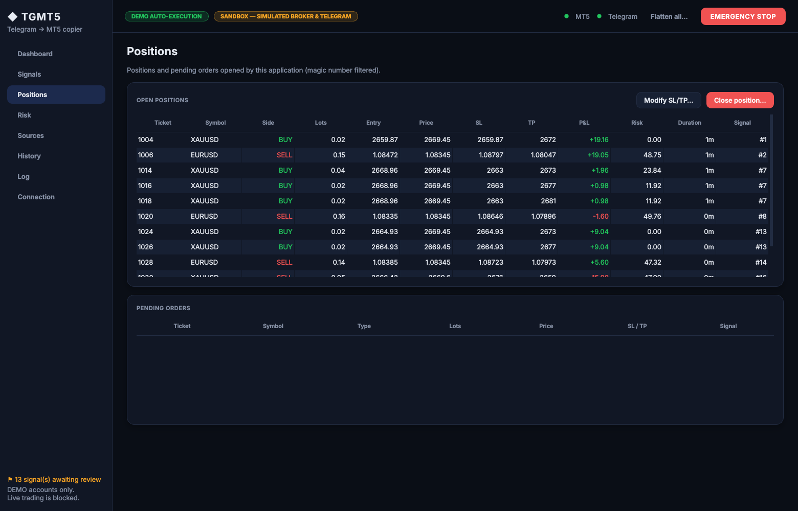
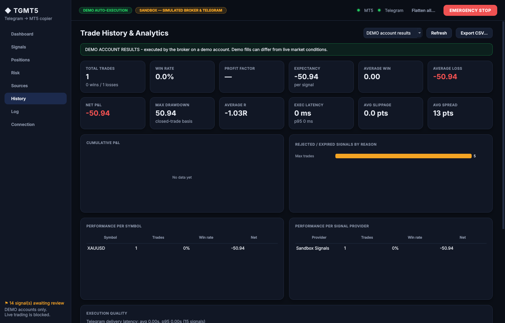

# TGMT5: Telegram → MetaTrader 5 copy trading

A Windows desktop application that reads trading signals from private Telegram groups you belong to, interprets them with a deterministic parser, runs every trade through a risk engine and executes it on a **MetaTrader 5 DEMO account** (built and tested against an IC Markets SC demo account model).

It starts in **monitor-only** mode, refuses non-demo accounts at the backend level, and never trades on a signal it cannot interpret with certainty.



> **Risk disclaimer.** This is an educational / portfolio project. It is restricted to demo accounts on purpose. Trading leveraged products such as forex and CFDs carries a high risk of losing money. Nothing in this repository is financial advice, and simulated or demo results do not predict live results. Use at your own risk; see [LICENSE](LICENSE).

## Highlights

- **Deterministic signal parser.** It handles market, entry-zone, explicit limit/stop and multi-TP signals, symbol aliases (GOLD → XAUUSD), and follow-up commands such as *move SL to BE*, *close 50%*, *cancel pending* and *TP1 hit*. If the symbol, direction, stop loss or entry is uncertain, the message goes to a **manual review queue**. The parser never invents values.
- **Lot sizing from the broker's own specs.** The loss at the stop is computed with `order_calc_profit()`, so currency conversion, contract size and tick value always come from the terminal. Volumes are rounded **down** to the broker's step, and a signal is rejected if even the minimum lot exceeds the risk budget. The whole risk budget for a signal is split across its TP legs, so three targets never mean three times the risk.
- **Risk engine.** Limits cover risk per signal and total open risk, a daily-loss lockout, a max-drawdown lockout, a consecutive-loss breaker, trade frequency, concurrent trades, per-symbol and correlated exposure, margin usage, free margin, spread, slippage, entry deviation, R:R, sessions and white/blacklists. Lockouts survive restarts.
- **Execution without duplicates.** Each order is written to SQLite with a unique client tag *before* it is sent. If the result is a timeout or connection loss, the leg becomes `UNCERTAIN` and is reconciled against MT5 positions, orders and deal history before any retry is allowed.
- **DEMO-only, twice.** The account is checked when connecting, and again on *every* trade request (`trade_mode == DEMO`, plus the configured login and server). If a live account is detected, the app engages a persistent emergency stop.
- **Restart recovery.** On start-up the app reconciles uncertain orders, positions closed while it was offline, expired waiting signals and unknown positions that carry its magic number. Old Telegram messages are never replayed.
- **Paper trading** uses live MT5 prices with modelled spread, slippage and commission. Its results are stored and shown separately from demo results.
- **Desktop UI** built with PySide6 and custom-painted charts. Screens: dashboard, live signal monitor with a status timeline, positions, risk console with estimated consequences, Telegram sources, analytics and a searchable audit log.

| Live signal monitor | Risk management |
|---|---|
|  |  |
| **Positions** | **History & analytics** |
|  |  |

*The screenshots come from the built-in **sandbox mode** (simulated broker and Telegram feed), so the numbers are synthetic.*

## Architecture

```
 Telegram (Telethon, MTProto user session)
        │  NEW / EDIT / DELETE events
        ▼
 bounded asyncio queue ──► MT5 worker thread (single, serial)
                              │
                              ├─ SignalParser        (pure, deterministic)
                              ├─ ExecutionEngine     (state machine, idempotency, reconciliation)
                              │     ├─ RiskEngine    (limits, lockouts; persisted)
                              │     ├─ sizing        (order_calc_profit, volume step/min/max)
                              │     └─ management    (BE, partials, trailing, follow-ups)
                              ├─ DemoOnlyGateway ──► MT5Gateway (MetaTrader5 | Paper | Fake)
                              └─ SQLite (SQLAlchemy + Alembic) — audit trail of every decision
        ▲
 PySide6 UI (qasync) ── calls AppService only; it has no access to order sending
```

All MetaTrader5 calls run on one worker thread, because the official package is not thread-safe. Running them serially also prevents races between signals that arrive at the same time. See [docs/ARCHITECTURE.md](docs/ARCHITECTURE.md) for the state machine, the database schema and design decisions.

## Quick start

```powershell
# Windows 11, Python 3.12+, MetaTrader 5 terminal installed
git clone https://github.com/iulian880/telegram-mt5-copier
cd telegram-mt5-copier
py -3.12 -m venv .venv; .\.venv\Scripts\Activate.ps1
pip install -e ".[dev]"
python -m tgmt5             # real mode (starts in MONITOR ONLY)
python -m tgmt5 --sandbox   # try everything with a simulated broker + Telegram feed (any OS)
```

Full guides:
- [Windows installation & packaging](docs/INSTALL_WINDOWS.md)
- [Telegram API setup](docs/TELEGRAM_SETUP.md)
- [IC Markets SC DEMO / MT5 setup](docs/MT5_DEMO_SETUP.md)
- [User guide](docs/USER_GUIDE.md) · [Troubleshooting](docs/TROUBLESHOOTING.md)
- [Test report & known limitations](docs/TEST_REPORT.md)

## Tests

```bash
pytest -q                    # 174 tests, no credentials or broker needed
pytest -m demo_e2e -s        # optional real DEMO round trip (Windows, explicit opt-in)
```

The suite covers parser formats and false positives, edits, duplicates, reply-based management, signal expiry, FX/XAU/JPY sizing, broker volume limits, risk caps, margin, lockouts, multi-TP allocation, broker rejections, timeouts with and without execution, disconnects, restarts and recovery, concurrent signals, partial closes, emergency stop, flatten-all, live-account blocking, secret redaction and a GUI smoke test.

## Tech stack

Python 3.12+ · MetaTrader5 · Telethon · PySide6 + qasync · SQLAlchemy 2 + Alembic · SQLite (WAL) · Pydantic 2 · keyring · pytest · PyInstaller · GitHub Actions

## License

MIT © 2026 Petcu
